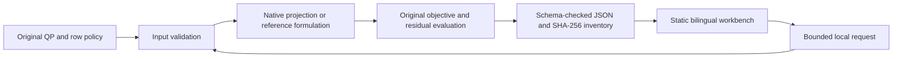

# Architecture

SoftQP Studio separates original-space policy, numerical optimization, exported evidence and browser replay. The native extension is owned by the separate public engine repository. This app owns authored inputs, physical row metadata, acceptance thresholds, experiment protocols and the reader.

A browser request is a portable file, not a network solve. The CLI checks its base digest and unchanged matrices before computing. The reader recomputes objective components and physical violations before accepting the returned record. Canonical, fixture and local-import origins remain explicit.

- [System and ownership](architecture/01_overview.md).
- [Determinism, provenance and timing](architecture/02_determinism-and-trace.md).
- [Execution-lane gate](architecture/03_the-gate.md).
- [Browser boundary](architecture/04_live-lane.md).
- [Scientific stages](architecture/05_precompute-pipeline.md).
- [Optimality and comparative evaluation](architecture/06_model-evaluation.md).
- [Deployment and promotion](architecture/07_deploy.md).
- [Contracts and missing evidence](architecture/08_data-contracts.md).

The [software design](design/SDD.md) owns acceptance requirements. Source tests, manuscript review, package distribution, deployed identity and owner acceptance are separate gates.
