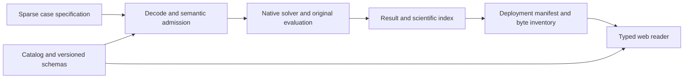

# Design: original-space contracts and availability

This current reconciliation describes the implemented boundaries. It does not assert that this document preceded their original implementation. The problem is broader than validating JSON syntax: a correctly shaped result can still name the wrong case, contradict its original matrices, or claim availability for evidence the browser cannot consume.

## Schema ownership and data flow

`docs/contracts/catalog.md` owns the boundary inventory, versions, schema files, examples, document globs and producer/consumer tests. `docs/contracts/versions.lock.json` binds normalized schema bytes to versions. Sparse input ingestion is `pipeline.io.contract.decode_problem`; it validates the case specification before constructing the public engine's `Problem` and `Penalty`. CSC offsets, sorted unique row indices, dimensions and mask lengths need semantic checks in addition to their JSON types.

`pipeline.softqp_run.validate_document` applies the declared schemas to numerical documents. Case export produces the scientific index and original-space result; `pipeline.core.manifest.export_manifests` builds the deployment index and per-case manifest. The web readers in `frontend/src/lib/softqp.ts` independently validate the loaded index/result, verify its SHA-256 and check the returned case identity. `frontend/scripts/gen-contract-types.mjs` derives TypeScript from `docs/contracts/api.openapi.json`, so a schema change without regenerated consumer types fails the build.

## Availability is a separate contract

`pipeline.core.readiness.compute` reads the catalog and actual selected artifact root without importing the numerical stack. Its output schema, `docs/contracts/schemas/readiness.schema.json`, declares one state per boundary. Active providers remain provider-labelled; real rows can be missing, partial, stale or available according to actual evidence. An index made by an older product version remains stale rather than being silently restamped. The catalog hash makes edited declarations detectable until readiness is recomputed.

The frontend reduces only the rows a view consumes. `viewState`, `unavailableRow` and `loadReadiness` in `frontend/src/readiness/readiness.ts` preserve the defined severity order and return unknown when readiness cannot be read. `ReadinessNote` is rendered by the actual consuming workbench and research pages. An unrelated missing research row cannot suppress a usable separable view. Conversely, a coupled schema example or public archive link cannot invent a deployed coupled adapter.

## Units, failure and API invariants

Each original row retains its unit and hard/soft policy. Lower and upper departures remain vectors with one entry per row; values in metres and metres per second are not summed into a physical error. Absent bounds use the schema's null convention and decode to signed infinity. A boolean is never admitted as a numeric coefficient. Unsupported method states retain reasons and null results instead of fabricated zeros.

The API remains dormant in the deployed static product. Its real read-only implementation in `app/main.py` is nevertheless checked against OpenAPI: only indexed manifests and declared artifact paths are served, absent/unreadable documents produce the typed 503 body, and traversal or undeclared paths produce the typed 404 body. The browser does not depend on this service to inspect committed evidence.

## Alternatives and proof obligations

Inferring readiness from file existence was rejected because examples and arbitrary local payloads do not establish a validated consumer. Trusting TypeScript casts alone was rejected because downloaded JSON is untrusted at runtime. Catalog globs do not exempt native binaries, environments or heavy data from repository policy.

CT-001 through CT-007 map schema/decoder/type behavior to `tests/contracts/test_documents.py`, `tests/test_contract.py` and the named frontend contract tests. CT-009 through CT-028 map readiness and read-only serving to `tests/contracts/test_readiness.py`, `tests/contracts/test_api.py` and the actual readiness consumer test. CT-034 through CT-043 cover catalog paths, repository admission and undeployed coupled evidence. The exact positive and hostile cases are enumerated in [validation](validation.md); dependencies and requirement coverage are in [tasks](tasks.md). A schema pass alone is not numerical or deployment acceptance.
